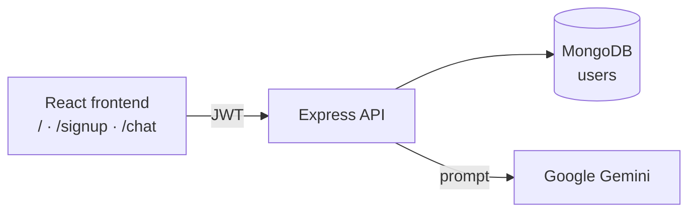

<div align="center">

# 💖 Ruchita AI: Health Assistant

**An AI wellness companion. Sign up, ask health questions and get friendly guidance powered by Google Gemini.**


### [🌐 Live demo](https://ruchita-ai-bot.vercel.app)

</div>

---

## ✨ Features

- **Sign up and log in** with JWT authentication (bcrypt-hashed passwords)
- **Ask health questions** and get guidance from **Google Gemini** (`gemini-1.5-flash`)
- **Example prompts** to get started quickly
- Chat UI with a typing indicator and toast notifications
- Protected chat route and logout

> [!IMPORTANT]
> Ruchita gives general wellness information only. It's **not a substitute for professional medical advice.**

## 🏗️ Architecture



## 📡 API

| Method | Endpoint | Description |
|:---:|---|---|
| `POST` | `/api/auth/signup` | Create an account |
| `POST` | `/api/auth/login` | Log in and receive a JWT |
| `POST` | `/api/user` | Create a user record (`{ "name": "..." }`) |
| `POST` | `/api/ask-health` | Ask a health question (`{ "prompt": "..." }`) |

## 🚀 Run locally

```bash
git clone https://github.com/mayurvij22/Ruchita-Ai-Bot.git
cd Ruchita-Ai-Bot
```

`backend/.env`:

```env
PORT=5000
MONGO_URI=your_mongodb_uri
JWT_SECRET=a-long-random-string
GEMINI_API_KEY=your_gemini_key
```

```bash
cd backend && npm install && npm run dev
cd ../frontend && npm install && npm run dev
```

## 🛠️ Tech stack

| Layer | Technology |
|---|---|
| Frontend | React, Vite, React Router, Tailwind CSS, react-hot-toast |
| Backend | Node.js, Express, Mongoose, JWT, bcryptjs |
| AI | Google Gemini |
| Hosting | Vercel |

---

<div align="center">

Made by **[Mayur Patil](https://github.com/mayurvij22)**

</div>
